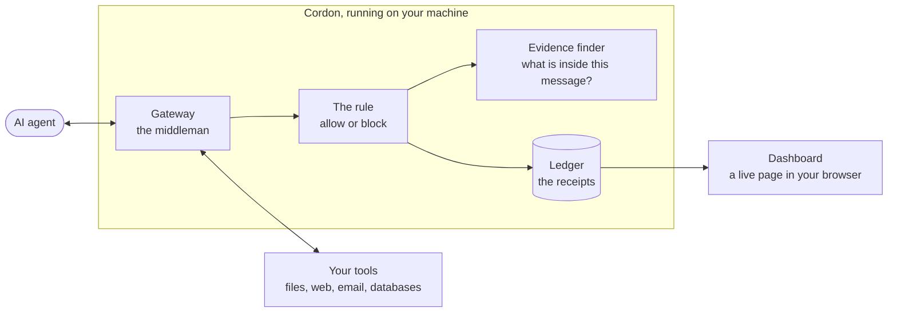
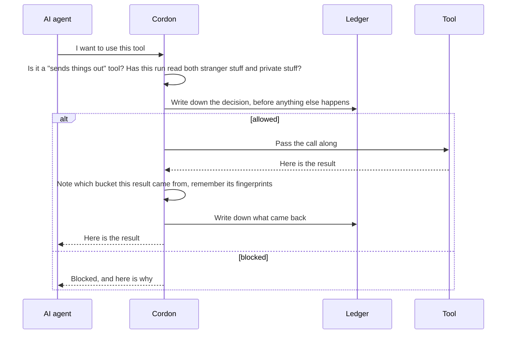

# How Cordon is put together

This is a plain English tour of the pieces inside Cordon and how they fit. No code here, just the shape of it.

If you haven't read the [main page](../README.md) yet, start there. It explains the problem in two minutes.

## The big picture

Cordon is a middleman.

AI agents use tools through a standard plug called MCP. You can think of it like USB, but for AI tools. Normally the agent plugs straight into each tool. With Cordon, the agent plugs into Cordon, and Cordon plugs into the tools.

That one change means every single tool call has to walk past Cordon. It can look at each call, decide if it's safe, and write down what happened.

## The pieces

### 1. The gateway (the middleman)

This is the part that speaks MCP. To the agent it looks like one normal tool server. Behind it, it talks to as many real tool servers as you like and passes messages back and forth.

MCP changed quite a lot in 2026, so there are now two "dialects" in the wild, an older one and a newer one. The gateway speaks both, on both sides. An older agent can talk to newer tools through it, and the other way round.

### 2. The labels (a short settings file)

You tell Cordon which bucket each tool belongs in:

- **Reads from strangers.** Web pages, bug reports, incoming email.
- **Reads private stuff.** Files, databases, secret keys.
- **Sends things out.** Web requests, outgoing email, public comments.

A tool can be in more than one bucket. A web browser tool, for example, both reads from strangers and sends things out.

This file is about ten lines long. If you make a typo in it, Cordon refuses to start. A security tool that quietly ignores a typo is worse than no security tool.

### 3. The rule (the lock)

For each run, Cordon keeps a tiny memory with two yes or no questions:

1. Has this agent read anything from a stranger yet?
2. Has this agent read anything private yet?

If both answers are yes, every "sends things out" tool is closed for the rest of that run. That's the lock. It's simple on purpose, because simple things are hard to fool.

### 4. The evidence finder (the detective)

The rule can block a call, but it's nice to know *what* was actually in the message. So Cordon remembers small fingerprints of the text that tools have returned. Later, when the agent tries to send something out, Cordon checks if pieces of that text are hiding inside.

It still spots them when they've been scrambled in the usual ways attackers use, like base64, hex, or web address encoding, including scrambled twice. Then it tells you things like "this message contains 243 bytes from your secrets file, scrambled as base64" and "this address was copied from the bug report".

One important thing: the detective is not the lock. A determined attacker can always invent a new way to scramble data. That's fine, because the rule in step 3 doesn't care what the message looks like. The detective is there to explain what happened, not to decide.

### 5. The ledger (the receipts)

Every decision goes into a log file on your machine. Each line carries a fingerprint of the line before it, like links in a chain. If someone edits a line, deletes one, or shuffles them around, the chain breaks at exactly that spot and Cordon can point to it.

The ledger never stores your secrets. When a message contains private data, Cordon writes down a fingerprint of the message, not the message itself. A security log that keeps a second copy of your passwords would be a bad joke.

### 6. The dashboard (the window)

A small web page that runs on your own machine and shows what's going on, live. You can see what the agent has read, which exits are open or closed, and the full list of calls with the reason for each decision.

The page doesn't load anything from the internet. No fonts, no scripts, no trackers. It also treats everything it shows as plain text, so a nasty web page that ended up in the log can't mess with the dashboard itself.

## The life of one tool call

Here's what happens every time the agent wants to use a tool.

Step by step:

1. The agent asks to use a tool.
2. Cordon checks the rule. This takes a couple of milliseconds at most.
3. Cordon writes the decision into the ledger **before** doing anything else. If the power went out right after, the record would still be there.
4. If the call is allowed, Cordon passes it to the real tool and waits for the answer.
5. When the answer comes back, Cordon notes which bucket it came from. This is the moment the "has read stranger stuff" or "has read private stuff" switch flips.
6. The agent gets the answer.
7. If the call is blocked, the tool is never contacted at all. The agent gets a clear message saying it was blocked and why, so it can tell you instead of trying again and again.

## Two modes

- **Watch-only.** Cordon checks every call and writes down what it *would* have blocked, but lets everything through. This is how you try it out without breaking anything.
- **Switched on.** Cordon actually blocks.

A sensible way to start is watch-only for a few days, read the ledger, then switch it on.

## Choices I made on purpose

**No AI inside.** If the guard is an AI, the guard can be tricked the same way the agent can. Cordon is plain logic. The same input always gives the same answer.

**Assume the agent is already fooled.** Cordon doesn't try to work out if the agent has been tricked. It acts as if it has, every time. That sounds gloomy, but it's the only assumption that still holds on a bad day.

**No outside packages.** The whole thing uses only what comes built in with its runtime. Fewer moving parts means fewer things that can be poisoned, and it's small enough for one person to read in an afternoon.

**Everything stays local.** The gateway, the ledger and the dashboard all run on your machine. Nothing phones home.

**When unsure, say no.** A typo in the settings stops Cordon from starting. A message it can't make sense of gets refused instead of waved through.

## What's outside the fence

Cordon can only guard the door it's standing at.

- If your agent has its own built-in web browser or command line that doesn't go through MCP, Cordon never sees it.
- It guards tool calls. Other things MCP can carry, like shared documents and prompt templates, aren't covered yet.
- "One run" means one launch of the gateway. The newest version of MCP has no way to say "this is a new conversation", so if your app keeps one gateway open across many chats, Cordon stays careful across all of them. It will never be too relaxed because of this, only too strict.
- The ledger shows tampering, but someone who can rewrite the whole file from scratch could fake a clean one. The fix is to copy the latest fingerprint somewhere safe now and then.

More on testing and limits in [the full write-up](paper.md).
